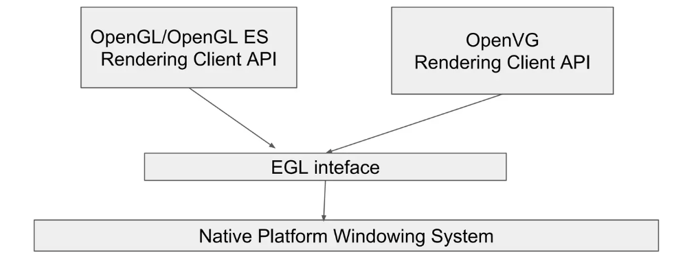

#### 一、什么是EGL

EGL（Embedded-System Graphics Library）


#### 二、EGL的作用
+ 连接“渲染 API”和“窗口系统”


OpenGL ES   <---------   EGL   --------->   Android 的 Surface / SurfaceTexture / ANativeWindow


<center>
    
</center>


+ 创建和管理 OpenGL ES 上下文（Context）

> Context = State + Resource


#### 三、API使用

```kotlin
        //获取显示设备
        eglDisplay = EGL14.eglGetDisplay(EGL14.EGL_DEFAULT_DISPLAY);
        if (eglDisplay == EGL14.EGL_NO_DISPLAY) {
            throw new RuntimeException("unable to get EGL14 display");
        }
```

```kotlin
        //初始化显示设备
        int[] version = new int[2];
        if (!EGL14.eglInitialize(eglDisplay, version, 0, version, 1)) {
            eglDisplay = null;
            throw new RuntimeException("unable to initialize EGL14");
        }
```


```kotlin
        //选择一个符合要求的配置项
        int[] attribList = {
                EGL14.EGL_RED_SIZE, 8,
                EGL14.EGL_GREEN_SIZE, 8,
                EGL14.EGL_BLUE_SIZE, 8,
                EGL14.EGL_RENDERABLE_TYPE,
                EGL14.EGL_OPENGL_ES2_BIT,
                EGL_RECORDABLE_ANDROID,
                1,
                EGL14.EGL_NONE
        };
        EGLConfig[] configs = new EGLConfig[1];
        int[] numConfigs = new int[1];
        if (!EGL14.eglChooseConfig(eglDisplay, 
                attribList, 0, 
                configs, 0, 
                configs.length,
                numConfigs, 0)) {
            throw new RuntimeException("unable to find RGB888+recordable ES2 EGL config");
        }
```


```kotlin
    // Configure context for OpenGL ES 2.0.
        int[] attrib_list = {
                EGL14.EGL_CONTEXT_CLIENT_VERSION, 
                2,
                EGL14.EGL_NONE
        };
        eglContext = EGL14.eglCreateContext(eglDisplay, 
                configs[0], EGL14.EGL_NO_CONTEXT,
                attrib_list, 0);
        checkEglError("eglCreateContext");
        if (eglContext == null) {
            throw new RuntimeException("null context");
        }
```


```kotlin
// Create a window surface, and attach it to the Surface we received.
        int[] surfaceAttribs = {
                EGL14.EGL_NONE
        };
        eglSurface = EGL14.eglCreateWindowSurface(eglDisplay,
                configs[0], 
                surface,
                surfaceAttribs, 0);
        checkEglError("eglCreateWindowSurface");
        if (eglSurface == null) {
            throw new RuntimeException("surface was null");
        }
```


#### eglSwapBuffers

```kotlin
    EGL14.eglSwapBuffers(eglDisplay, eglSurface)
```
1) 它交换的是什么？

对 Window Surface（绑定了 Android Surface/ANativeWindow）来说，通常是双/三缓冲队列：

+ Back buffer：你用 GLES 正在画的那块 buffer
+ Front buffer（或“已提交 buffer”）：系统/显示控制器/消费者正在使用的 buffer

eglSwapBuffers 做两件事：

- 1.Flush/完成提交：确保 GPU 对这帧的渲染命令已经提交到驱动（很多实现还会隐含同步点）
- 2.QueueBuffer：把当前 back buffer 放进 Surface 的 BufferQueue（“交给系统/消费者”）
- 3.Dequeue下一个 back buffer：取回一块新的 buffer 作为下一帧的绘制目标（下一次 glClear/glDraw 就画到新的 back buffer）

所以它不是简单“交换指针”，而是和 Android 的 buffer queue 在交互。


 #### 参考
[Understaing Android EGL](https://www.slideshare.net/slideshow/understaing-android-egl/68896158)