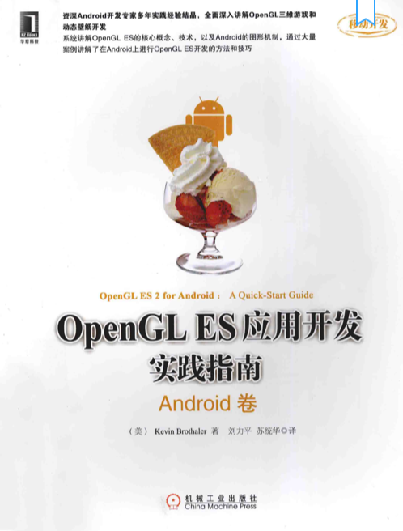

最近学习了一些OpenGL相关的知识，把学习过程中，找到的学习资源汇总一下，方便后续翻看。

#### 一、OpenGL ES的基础知识：

基础入门可看：

<table>
    <tr>
        <td></td>
        <td>OpenGL ES应用开发实践指南Android卷</td>
    </tr>
</table>

#### 二、Shader着色器

[the-book-of-shaders](https://github.com/patriciogonzalezvivo/thebookofshaders)

[shader分享网站](https://www.shadertoy.com/)

[shader在线编辑预览](https://thebookofshaders.com/edit.php)
