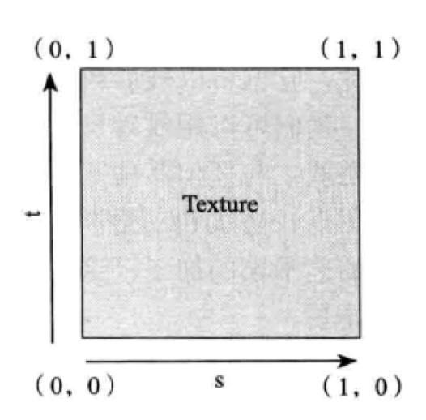

一、纹理坐标

<center>
    
</center>


#### 二、API介绍

##### 1、生成纹理ID（向 GPU 申请若干个“纹理句柄”）

```java
        final int[] textureObjId = new int[1];
        //生成纹理的数量
        //接收生成的纹理ID
        //数组便宜，从数组的哪个脚标开始读取
        GLES20.glGenTextures(1, textureObjId, 0);

        if (textureObjId[0] == 0) {
            Log.d("opengl", "产生纹理出错");
            return;
        }
```

##### 2、加载图像

```java
        final BitmapFactory.Options options = new BitmapFactory.Options();
        options.inScaled = false;//不缩放

        final Bitmap bitmap = BitmapFactory.decodeResource(context.getResources(),
                resourceId, options);

        if (bitmap == null) {

            GLES20.glDeleteTextures(1, textureObjId, 0);
            return 0;
        }
```


##### 3、绑定纹理对象

告诉OpenGL后面的纹理操作都应用于这个纹理对象。

```java
    //这是一个二维纹理
    //纹理操作应用于 textureObjId[0] 这个纹理对象
  GLES20.glBindTexture(GLES20.GL_TEXTURE_2D, textureObjId[0]);
```


##### 4、配置纹理过滤


```java
        GLES20.glTexParameteri(GLES20.GL_TEXTURE_2D,//缩小的情况下
                GLES20.GL_TEXTURE_MIN_FILTER,
                GLES20.GL_LINEAR_MIPMAP_LINEAR);//缩小情况下使用三线性过滤

        GLES20.glTexParameteri(GLES20.GL_TEXTURE_2D,//放大的情况下
                GLES20.GL_TEXTURE_MAG_FILTER,
                GLES20.GL_LINEAR);//放大情况下使用双线性过滤
```

| 过滤模式 | 说明 |
|----------|------------------------------|
| GL_NEAREST | 最近邻过滤 |
| GL_NEAREST_MIPMAP_NEAREST | 使用 MIP 贴图的最近邻过滤 |
| GL_NEAREST_MIPMAP_LINEAR | 使用 MIP 贴图级别之间插值的最近邻过滤 |
| GL_LINEAR | 双线性过滤 |
| GL_LINEAR_MIPMAP_NEAREST | 使用 MIP 贴图的双线性过滤 |
| GL_LINEAR_MIPMAP_LINEAR | 三线性过滤（使用 MIP 贴图级别之间插值的双线性过滤） |


+ 缩小（Minification）

| 支持模式 |
|----------------------------|
| GL_NEAREST |
| GL_NEAREST_MIPMAP_NEAREST |
| GL_NEAREST_MIPMAP_LINEAR |
| GL_LINEAR |
| GL_LINEAR_MIPMAP_NEAREST |
| GL_LINEAR_MIPMAP_LINEAR |


+ 放大（Magnification）

| 支持模式 |
|--------------|
| GL_NEAREST |
| GL_LINEAR |


##### 5、加载纹理到OpenGL

```java
    //纹理类型GL_TEXTURE_2D、GL_TEXTURE_EXTERNAL_OES、GL_TEXTURE_CUBE_MAP
    //
    //要上传的 CPU 内存图片数据
    //桌面 OpenGL 才支持 border
    GLUtils.texImage2D(GLES20.GL_TEXTURE_2D, 0, bitmap, 0);
```
+ bitmap传到GPU就可以回收了
+ 与*GLUtils.texSubImage2D*的区别？
+ 与*GLES20.glTexImage2D*的区别？


##### 6、纹理环绕


##### 7、解绑纹理
```java
    GLES20.glBindTexture(GLES20.GL_TEXTURE_2D, GLES20.GL_NONE);
```